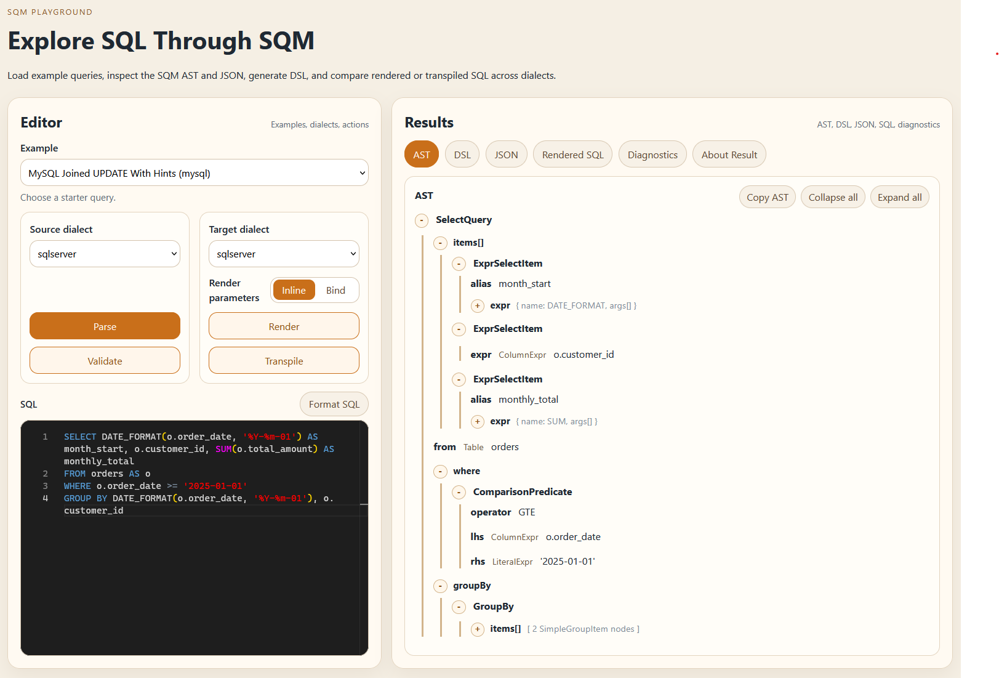

# SQM - Structured Query Model for Java

[](https://github.com/icher-g/sqm/actions/workflows/publish-maven.yml)
[](LICENSE)
[](https://github.com/icher-g/sqm/packages)
[](https://codecov.io/gh/icher-g/sqm)

SQM represents SQL as a typed, immutable Java model. Build queries and DML with a
fluent DSL, parse existing SQL, validate and rewrite it, then render it for your
database. The same model supports JSON, Java code generation, and SQL middleware.

SQL text → model → validation / transformation → SQL + parameters

## Get started

Use Java 21 or later and the same SQM version for every dependency. Set
`sqm.version` to the release you want to use.

```xml
<dependency>
  <groupId>io.sqm</groupId>
  <artifactId>sqm-core</artifactId>
  <version>${sqm.version}</version>
</dependency>
<dependency>
  <groupId>io.sqm</groupId>
  <artifactId>sqm-render-ansi</artifactId>
  <version>${sqm.version}</version>
</dependency>
```

```java
import static io.sqm.dsl.Dsl.*;
import io.sqm.render.ansi.spi.AnsiDialect;
import io.sqm.render.spi.RenderContext;

var query = select(col("u", "id"), col("u", "name"))
    .from(tbl("users").as("u"))
    .where(col("u", "id").eq(lit(7L)))
    .build();
var renderer = RenderContext.of(new AnsiDialect());
var sql = renderer.render(query).sql();
```

[Getting started and dependencies](wiki-src/Getting-Started.md) ·
[DSL examples, joins, grouping, and arithmetic](wiki-src/DSL-Usage.md)

The following examples reuse `query` and `renderer`; each guide covers its module
dependencies and full setup.

## Parse existing SQL

Add the parser module for your dialect and inspect errors before using the model.

```java
var parser = ParseContext.of(new AnsiSpecs());
var parsed = parser.parse(Query.class, "SELECT id, name FROM users");
if (!parsed.ok()) throw new IllegalArgumentException(parsed.errorMessage());
var model = parsed.value();
```

[Parsing and statement sequences](wiki-src/Parsing-SQL.md) ·
[Rendering SQL](wiki-src/Rendering-SQL.md)

## Choose a dialect

| Dialect | Guide |
|---|---|
| ANSI | [Shared model and support boundaries](wiki-src/Core-Model.md) |
| PostgreSQL | [PostgreSQL dialect](wiki-src/PostgreSQL-Dialect.md) |
| MySQL | [MySQL dialect](wiki-src/MySQL-Dialect.md) |
| SQL Server | [SQL Server dialect](wiki-src/SQL-Server-Dialect.md) |
| Oracle | [Oracle dialect](wiki-src/Oracle-Dialect.md) |

For example, render the same common query with Oracle's renderer:

```java
var oracleSql = RenderContext.of(new OracleDialect()).render(query).sql();
```

A shared node is representable in the model; each dialect decides which syntax
it can parse, render, validate, and transpile. See the
[support matrix](docs/downstream/DOWNSTREAM_SUPPORT_MATRIX.md) and
[unsupported features](wiki-src/Unsupported-Features.md).

## Build DML statements

```java
var change = update("users")
    .set("name", lit("Alice"))
    .where(col("id").eq(lit(7L)))
    .build();
```

[INSERT, UPDATE, DELETE, MERGE, and returned values](wiki-src/DML-Statements.md)

## Validate against a schema

```java
var schema = CatalogSchema.of(
    CatalogTable.of("public", "users",
        CatalogColumn.of("id", CatalogType.LONG),
        CatalogColumn.of("name", CatalogType.STRING)));
var validation = SchemaStatementValidator.of(schema).validate(query);
validation.problems().forEach(System.out::println);
```

[Schema validation and policies](wiki-src/Schema-Validation.md) ·
[JSON/JDBC schema providers](wiki-src/Schema-Introspection.md)

## Transform and inspect models

```java
var renamed = IdentifierTransforms.renameColumn(query, "u", "name", "display_name");
var kind = Match.<String>query(query).select(q -> "SELECT").orElse("other query");
```

[Task-oriented transform helpers](wiki-src/Query-Transform-Helpers.md) ·
[Visitors, transformers, collectors, and matching](wiki-src/Traversal-and-Matching.md)

## Render bind parameters

```java
var bound = renderer.render(query, RenderOptions.of(ParameterizationMode.Bind));
System.out.println(bound.sql());    // WHERE u.id = ?
System.out.println(bound.params()); // [7]
```

[Parameter types, rendering modes, and binding](wiki-src/Parameters-and-Binding.md)

## Transpile between dialects

```java
var result = SqlTranspiler.builder()
    .sourceDialect(SqlDialectId.POSTGRESQL)
    .targetDialect(SqlDialectId.MYSQL)
    .build()
    .transpile("SELECT first_name || ' ' || last_name AS full_name FROM users");
System.out.println(result.sql().orElseThrow());
```

The result distinguishes exact conversions, opted-in approximations, and
unsupported features.

[Transpilation setup and diagnostics](wiki-src/SQL-Transpilation.md) ·
[Dialect conversion examples](wiki-src/SQL-Transpilation-Examples.md)

## Apply runtime SQL policies

```java
var middleware = SqlDecisionService.create(
    SqlDecisionServiceConfig.builder(schema).buildValidationConfig());
var decision = middleware.analyze(
    "SELECT id FROM users", ExecutionContext.of("postgresql", ExecutionMode.ANALYZE));
System.out.println(decision.kind());
```

[Middleware, guardrails, and rewrite policies](wiki-src/SQL-Middleware-Framework.md) ·
[REST and MCP hosts, configuration, and named pipes](wiki-src/Middleware-Transports.md)

## Serialize models as JSON

```java
var mapper = SqmJsonMixins.createPretty();
var json = mapper.writeValueAsString(query);
var restored = mapper.readValue(json, Query.class);
```

[JSON serialization and round trips](wiki-src/JSON-Serialization.md)

## Generate Java from SQL files

Put SQL in `src/main/sql/user/find_by_id.sql` and configure the codegen plugin:

```sql
SELECT id, name FROM users WHERE id = :id
```

Use the generated factory and parameter metadata:

```java
var generated = UserQueries.findById();
var parameterNames = UserQueries.findByIdParams();
```

[Maven code generation](wiki-src/SQL-File-Codegen.md) ·
[Schema-aware generation](wiki-src/SQL-File-Codegen-Schema-Validation.md)

## Explore the playground

Inspect the model, SQL, JSON, generated DSL, and diagnostics in the playground.

```bash
docker run --rm -p 8080:8080 igorcher/sqm-playground:latest
```

Open [localhost:8080](http://localhost:8080).



[Playground guide, local builds, and Docker publishing](wiki-src/SQM-Playground.md)

## Develop and test

```bash
mvn -B verify
```

[Development setup and test suites](wiki-src/Development-and-Testing.md) ·
[Live PostgreSQL, MySQL, SQL Server, and Oracle tests](wiki-src/Integration-Testing-with-Docker.md)

## Architecture and reference

- [Architecture, module families, and data flow](wiki-src/Architecture.md)
- [Core model](wiki-src/Core-Model.md) and [full node hierarchy](docs/model/MODEL.md)
- [Runnable examples](wiki-src/Examples-Module-Guide.md)
- [Published wiki](https://github.com/icher-g/sqm/wiki) and [wiki source index](wiki-src/Home.md)
- [Roadmap](docs/planning/ROADMAP.md) and [issues](https://github.com/icher-g/sqm/issues)
- [Contributor rules](AGENTS.md)

## License

[MIT](LICENSE). Developed and maintained by [icher-g](https://github.com/icher-g).
